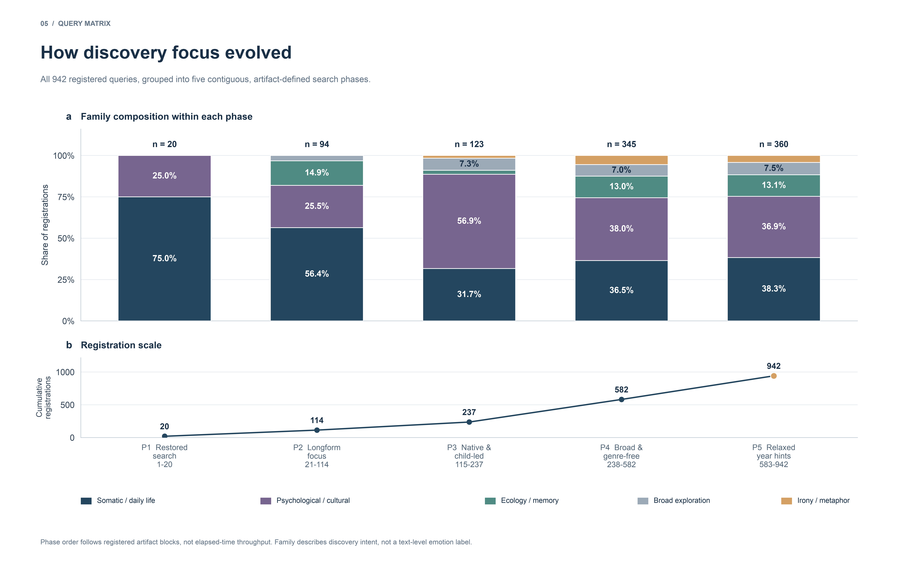

# Fear of Temperature

### Learning to fear temperature as shared cultural heritage — the Australian case

[](docs/research/2026-11-13-corpus-release/README.md)
[](docs/research/2026-11-13-corpus-release/collection_summary.json)
[](docs/research/2026-11-13-corpus-release/ACQUISITION_PROCESS.md)
[](docs/research/2026-11-13-corpus-release/NEXT_STEPS.md)
[](https://www.python.org/)
[](#license)

**Updated 13 November 2026. Raw acquisition is complete: 801,559 formal records.**
The project examines how climate/temperature-related affect, bodily experience and Fear
develop and circulate in Australian discourse during **1 January 2003–31 December 2025**.
This activity window was selected using the government/official acquisition inventory as
temporal reference, then fixed for public-expression collection. Older official and
international holdings retain their documented background scopes.

The macro hypothesis is **learning to fear temperature as shared cultural heritage**.
It is a hypothesis to test, not a result embedded in collection labels or an assumed rising curve.
The Australian case does not by itself establish global generality.

## Current progress

| Workstream | Status and evidence |
|---|---|
| Raw acquisition | **Complete:** 776,559 frozen baseline + 25,000 actual net additions = **801,559 formal records** |
| Final targeted phase | 26,383 gross receipts minus 1,383 reversible holds; 530 domains and all 23 publication years |
| Search documentation | Frozen v3.15: 10 parents, 24 sub-parents, 638 children; 942 actual query registrations and 4,169 saved jobs |
| Review and design | Final-phase verification and bounded independent review recorded; preprocessing and evaluation design documented |
| Next stage | Derived text views and bounded pilot implementation, followed by gold annotation and validated measurement |
| Empirical findings | Full-corpus labels, validated Fear trends and cultural-learning conclusions **not yet established** |

The dated 2003–2025 formal view contains 801,516 records; 43 baseline records with unresolved
dates remain separately preserved. Counts are native records, not independent people,
purely negative texts, keyword occurrences or model chunks.

Start with the [collection closeout](docs/research/2026-11-13-corpus-release/README.md),
[decision history](docs/research/2026-11-13-corpus-release/DECISION_HISTORY.md) and
[next-stage plan](docs/research/2026-11-13-corpus-release/NEXT_STEPS.md).

## Research questions

1. **RQ1 — Longitudinal development.** How do broad climate/temperature-negative affect,
   worry/anxiety and Fear develop over 2003–2025? After accounting for source, genre,
   capture, version and event composition, are the patterns consistent with learning and
   culturally shared responses?
2. **RQ2 — Valid classification and scoring.** Can validated ML/DL recognize the continuum
   from mild/somatic/indirect negative expression to Fear, distinguish affect subtypes,
   and provide calibrated intensity scores and uncertainty?
3. **RQ3 — Event-centred change.** How do affect, Fear, targets and narrative attributions
   change before, during and after independently evidenced climate/temperature events?

See the [accepted research decision](docs/research/2026-11-13-corpus-release/RESEARCH_QUESTIONS.md)
for hypotheses and interpretation limits. These questions supersede the earlier
numerical-inventory-first/deferred-Fear framing. Government records remain event/context
evidence; they do not impose a mandatory government/media/public three-series model.

## Corpus and acquisition

Material includes personal/community blogs and diaries, authored articles and publications,
forum posts and public comments. Native genre, quotation, speaker, publisher and work/version
relations remain distinct. Australian source/context evidence does not prove an author's
residence or national representativeness.

The [complete query matrix](docs/methodology/search/QUERY_MATRIX.md) includes bodily and
daily-life effects, fear/anxiety, ecological grief, irony/metaphor, cultural learning and
policy/scientist/alarmism backlash. Mild, medical, positive, neutral and mixed cases are retained.
Query association is not a gold emotion label. Preference for longer original narratives has
no hard minimum: complete shorter native fields remain their actual genres.

Soft family and historical-deficit weights guide discovery effort. Year, city and genre are
optional query dimensions; eligible 2019 material is included. Native APIs/archives and
web candidates feed separate body-capture and formal-write stages. Search counts and
returned fields never substitute for actual deduplicated admissions.

Read the [acquisition process](docs/research/2026-11-13-corpus-release/ACQUISITION_PROCESS.md)
and [search registers](docs/methodology/search/README.md) for implementation and accounting.

## Query matrix and progress figures



[All seven high-resolution figures](docs/research/2026-11-13-corpus-release/FIGURES.md)
cover matrix architecture, nested hierarchy, Fear taxonomy, version history, search-family
progress, query-feature evolution and year targeting versus actual additions.
The [executed Jupyter notebook](docs/research/2026-11-13-corpus-release/query_matrix_visualizations.ipynb)
contains complete code, frozen aggregate inputs and seven embedded outputs.
These figures describe search definitions/effort and recorded acquisitions, not emotion prevalence.

## Reproducible workspace

The repository contains a Python/NLP research workspace with DuckDB/Parquet provenance,
lexical and embedding baselines, candidate emotion/topic modules, temporal diagnostics,
notebooks and synthetic fixtures. Existing demo models are infrastructure candidates,
not an adopted or validated production climate-Fear classifier.

```bash
git clone https://github.com/dpan538/fear-of-temperature.git
cd fear-of-temperature
./scripts/bootstrap.sh
.venv/bin/fear-temperature-doctor --full-models
.venv/bin/fear-temperature-demo --offline
```

Python 3.12 dependencies are locked in [uv.lock](uv.lock). The workspace has previously
been validated on macOS Apple Silicon with MPS and CPU fallback; a fresh run needs
its own acceptance record. Start with [workspace checks](notebooks/01_workspace_check.ipynb)
and the [synthetic demonstration](notebooks/02_synthetic_end_to_end.ipynb).

To reproduce the closed phase's designed jobs without network or corpus access:

```bash
.venv/bin/python scripts/search/build_query_jobs.py --output /tmp/fear-temperature-designed-jobs.json
```

## Documentation and data access

| Document | Purpose |
|---|---|
| [Closeout and accounting](docs/research/2026-11-13-corpus-release/README.md) | Final quantities, qualification scope, storage and data access |
| [Research questions](docs/research/2026-11-13-corpus-release/RESEARCH_QUESTIONS.md) | Current RQ1–RQ3 and hypotheses |
| [Decision history](docs/research/2026-11-13-corpus-release/DECISION_HISTORY.md) | Scope, matrix, weighting and closure decisions |
| [Acquisition process](docs/research/2026-11-13-corpus-release/ACQUISITION_PROCESS.md) | Discovery-to-commit implementation and provenance |
| [Search definitions and registers](docs/methodology/search/README.md) | Complete matrix, historical versions, weights and actual/planned distinctions |
| [Next-stage design](docs/research/2026-11-13-corpus-release/NEXT_STEPS.md) | Derived preprocessing, grouping, evaluation and measurement |
| [Publication manifest](docs/research/2026-11-13-corpus-release/PUBLICATION_MANIFEST.json) | Public file hashes and original source references |
| [Environment](docs/ENVIRONMENT.md) | Installation and device/model configuration |
| [Data, models and governance](docs/DATA_MODELS_AND_GOVERNANCE.md) | Licences, provenance and research-use limits |
| [Historical project log](docs/PROJECT_LOG.md) | Dated earlier decisions and stages; latest status appears first |

Raw text, source responses, PDFs, databases, detailed record evidence and holding tracks
remain local. **Cloning this repository does not provide the corpus.** No raw snapshot,
data deposit, migration or acquisition restart is performed by this methods release.
Source-specific rights/privacy review is required before any text redistribution.

## Research boundaries

The final current-phase verification and bounded independent review are not whole-corpus
semantic clearance. Source concentration, archival access, changing capture, chronology,
quotation and narrator boundaries remain analysis concerns. Preserve native dates,
positive/neutral texts and repeated expressions rather than pruning a desired temporal trend.
Validated annotation and group-disjoint model evaluation precede substantive emotion claims.

## Citation

No DOI or archival data release has been assigned. Cite the repository and the exact commit:

```bibtex
@software{pan_fear_of_temperature_2026,
  author = {Pan, Dai},
  title = {Fear of Temperature: Australian Climate Affect and Cultural Learning, 2003--2025},
  year = {2026},
  url = {https://github.com/dpan538/fear-of-temperature},
  note = {Research infrastructure and acquisition-method documentation; cite the exact commit}
}
```

## Contributing

Discuss substantial changes through GitHub Issues. Preserve provenance and do not submit
restricted text, credentials or unlicensed corpora. Existing code checks are:

```bash
.venv/bin/ruff check src tests
.venv/bin/mypy src
.venv/bin/pytest
```

## License

No repository-wide licence has been assigned. Third-party packages, models and source
materials retain their own terms; public access is not a blanket redistribution licence.

## Contact

Project owner: **Dai Pan** ([@dpan538](https://github.com/dpan538)).
Use [GitHub Issues](https://github.com/dpan538/fear-of-temperature/issues) for public
code/documentation questions; keep private or restricted evidence out of public issues.
