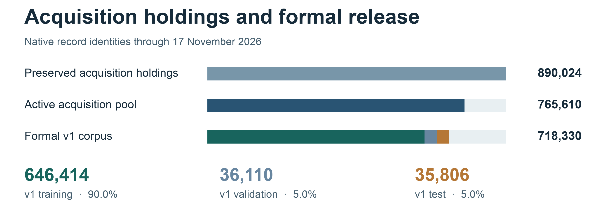
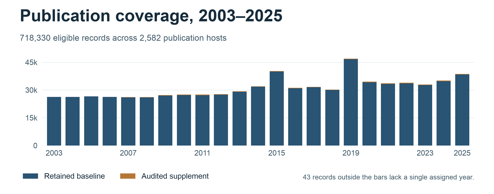

# Fear of Temperature

### Learning to fear temperature as shared cultural heritage — the Australian case

[](docs/research/2026-11-13-corpus-release/README.md)
[](notebooks/PREPROCESSING_CHECKPOINT.md)
[](docs/research/2026-11-13-corpus-release/ACQUISITION_PROCESS.md)
[](notebooks/PREPROCESSING_CHECKPOINT.md)
[](https://www.python.org/)
[](LICENSE)

**Current formal analysis release: 718,330 records.**
The project examines how climate/temperature-related affect, bodily experience and Fear
develop and circulate in Australian discourse during **1 January 2003–31 December 2025**.
This activity window was selected using the government/official acquisition inventory as
temporal reference, then fixed for public-expression collection. Older official and
international holdings retain their documented background scopes.

The macro hypothesis is **learning to fear temperature as shared cultural heritage**.
It is a hypothesis to test, not a result embedded in collection labels or an assumed rising curve.
The Australian case does not by itself establish global generality.

## Research stages

| Stage | Scope and current checkpoint |
| --- | --- |
| **1. Acquisition and formal release** | The formal analysis input contains **718,330 eligible records** from **2,582 publication hosts**. Acquisition is paused. |
| **2. Document preprocessing** | [Notebooks 03–05](notebooks/03_structure_normalization.ipynb) normalize metadata, apply auditable format-specific cleaning, and bind cleaned documents to provenance, paragraph offsets and overlap evidence. The full document handoff is verified. |
| **3. Chunking and quality review** | [Notebook 12](notebooks/12_reference_chunk_materialization.ipynb) materialized **1,511,656 reference chunks**. The 1,500-document semantic audit is complete. [Notebook 14](notebooks/14_paragraph_boundary_refinement.ipynb) generated 464 training-side alternatives for paired review. Model-ready chunk adoption is pending. |
| **4. Document EDA and unsupervised preparation** | [Notebook 13](notebooks/13_document_eda_and_unsupervised_preparation.ipynb) uses the document handoff for corpus diagnostics and a 20,000-document training-only TF–IDF cohort. [Notebook 15](notebooks/15_unsupervised_research_plan_and_local_pilot.ipynb) defines the hypotheses and provides a researcher-started local NMF pilot. [Run All comparison](notebooks/16_document_unsupervised_comparison.ipynb) |
| **5. Annotation and model evaluation** | Establish the annotation rubric and use group-disjoint evaluation for supervised comparisons. Representation experiments that consume chunks depend on Stage 3 adoption. |

### Corpus counts and the training target

[](docs/research/2026-11-17-formal-corpus-release/deposit_v1/README.md#corpus-accounting)

The two acquisition snapshots preserve **890,024 native records** in total,
including retained holds. The **801,559-record** historical snapshot assigned
**721,793** records to its historical training split. Phase 32 replenished the
candidate pool following eligibility screening and contributed 88,465 new
native identities, including 40,386 appendix holds. The resulting active
candidate pool contains **765,610** records.

The frozen release, `formal-corpus-release-20261117-v1`, retains **723,158**
records in its database. This includes **4,828** structural holds with native
body locators in `quarantine_records`. The canonical release inventory covers
**722,160** distinct native bodies, including **4,826** from structural holds.
The **67,222** historical records with recorded source-use holds are indexed
separately for reference. Their native identities are outside the v1
materialized roster.

The **718,330** eligible records are assigned to **646,414 train**, **36,110
validation** and **35,806 test** in the v1 catalog. The document workflow
separately holds **732** records whose original bodies exactly match historical
reference holds, with 663 in train, 42 in validation and 27 in test. Applying
this hold alone leaves **645,751 train**, **36,068 validation** and **35,779
test**. After the remaining overlap and input holds and exact-text
canonicalization, the document EDA uses **641,180** eligible training documents.
Its development cohort contains **20,000** documents. [Replay the corpus freeze](notebooks/17_corpus_freeze_replay.ipynb)

The successor target is **about 720,000 training records**. An exact
90:5:5 allocation at 720,000 training records needs **800,000 eligible
records**, including 40,000 each for validation and test. This requires a separately
versioned and verified split. [Historical closeout](docs/research/2026-11-13-corpus-release/README.md) · [Preprocessing checkpoint](notebooks/PREPROCESSING_CHECKPOINT.md)

[](docs/research/2026-11-17-formal-corpus-release/deposit_v1/year_by_stage.csv)

### Document preprocessing checkpoint

The versioned handoff preserves source and date provenance, release keys and inherited
splits. Source and format rules produce derived text and audit records. Native source
text and missing metadata remain available through their provenance links. Review
flags and overlap evidence follow each document into downstream eligibility checks.

### Chunking checkpoints

1. Plan reference offsets and materialize the original slices with a 512-content-token
   `cl100k_base` budget. Verify coverage and hashes and apply parent and exact-reuse holds.
2. Check semantic boundaries with the targeted nonparagraph review and the program-only
   sample. Record material evidence breaks separately from readability preferences.
3. Develop a bounded repair on training cases. Verify offset coverage and exact reuse,
   then review the original and proposed spans side by side before applying changes.
4. Validate the selected model's tokenizer and full input limit, including special
   tokens. Recheck exact cross-split reuse on the resulting offsets and version the
   approved chunk policy with its remaining holds.

The document EDA branch reads complete derived bodies from Stage 2. The
[preprocessing checkpoint](notebooks/PREPROCESSING_CHECKPOINT.md) records what was
run, what was held and which decisions are still open.

Earlier collection totals and search effort are documented in the [historical collection closeout](docs/research/2026-11-13-corpus-release/README.md).

## Research questions

1. **RQ1 — Longitudinal development.** How do broad climate/temperature-negative affect,
   worry/anxiety and Fear develop over 2003–2025? After accounting for source, genre,
   capture, version and event composition, are the patterns consistent with learning and
   culturally shared responses?
2. **RQ2 — Valid classification and scoring.** Can validated ML/DL recognize the continuum
   from mild/somatic/indirect negative expression to Fear, distinguish affect subtypes,
   and provide calibrated intensity scores and uncertainty?
3. **RQ3 — Event-centred change.** How do affect, Fear, targets and narrative attributions
   change before, during and after independently evidenced climate/temperature events?

See the [accepted research decision](docs/research/2026-11-13-corpus-release/RESEARCH_QUESTIONS.md)
for hypotheses and interpretation limits. These questions supersede the earlier
numerical-inventory-first/deferred-Fear framing. Government records remain event/context
evidence; they do not impose a mandatory government/media/public three-series model.

## Corpus and acquisition

Material includes personal/community blogs and diaries, authored articles and publications,
forum posts and public comments. Native genre, quotation, speaker, publisher and work/version
relations remain distinct. Australian source/context evidence does not prove an author's
residence or national representativeness.

The [complete query matrix](docs/methodology/search/QUERY_MATRIX.md) includes bodily and
daily-life effects, fear/anxiety, ecological grief, irony/metaphor, cultural learning and
policy/scientist/alarmism backlash. Mild, medical, positive, neutral and mixed cases are retained.
Query association is not a gold emotion label. Preference for longer original narratives has
no hard minimum: complete shorter native fields remain their actual genres.

Soft family and historical-deficit weights guide discovery effort. Year, city and genre are
optional query dimensions; eligible 2019 material is included. Native APIs/archives and
web candidates feed separate body-capture and formal-write stages. Search counts and
returned fields never substitute for actual deduplicated admissions.

Read the [acquisition process](docs/research/2026-11-13-corpus-release/ACQUISITION_PROCESS.md)
and [search registers](docs/methodology/search/README.md) for implementation and accounting.

## Query matrix and progress figures


[All seven high-resolution figures](docs/research/2026-11-13-corpus-release/FIGURES.md)
cover matrix architecture, nested hierarchy, Fear taxonomy, version history, search-family
progress, query-feature evolution and year targeting versus actual additions.
The [executed Jupyter notebook](docs/research/2026-11-13-corpus-release/query_matrix_visualizations.ipynb)
contains complete code, frozen aggregate inputs and seven embedded outputs.
These figures describe search definitions/effort and recorded acquisitions, not emotion prevalence.

## Reproducible workspace

The repository contains a Python/NLP research workspace with DuckDB/Parquet provenance,
lexical and embedding baselines, candidate emotion/topic modules, temporal diagnostics,
notebooks and synthetic fixtures. Existing demo models are infrastructure candidates,
not an adopted or validated production climate-Fear classifier.

```bash
git clone https://github.com/dpan538/fear-of-temperature.git
cd fear-of-temperature
./scripts/bootstrap.sh
.venv/bin/fear-temperature-doctor --full-models
.venv/bin/fear-temperature-demo --offline
```

Python 3.12 dependencies are locked in [uv.lock](uv.lock). The workspace has previously
been validated on macOS Apple Silicon with MPS and CPU fallback; a fresh run needs
its own acceptance record. Start with [workspace checks](notebooks/01_workspace_check.ipynb)
and the [synthetic demonstration](notebooks/02_synthetic_end_to_end.ipynb).

To reproduce the closed phase's designed jobs without network or corpus access:

```bash
.venv/bin/python scripts/search/build_query_jobs.py --output /tmp/fear-temperature-designed-jobs.json
```

## Documentation and data access

| Document | Purpose |
|---|---|
| [Frozen corpus companion](docs/research/2026-11-17-formal-corpus-release/deposit_v1/README.md) | Aggregate tables, checksum evidence and catalog restoration |
| [Preprocessing and chunking checkpoint](notebooks/PREPROCESSING_CHECKPOINT.md) | Current formal scope, verified notebook outputs and open acceptance gates |
| [Historical closeout](docs/research/2026-11-13-corpus-release/README.md) | Earlier collection quantities, qualification scope, storage and data access |
| [Research questions](docs/research/2026-11-13-corpus-release/RESEARCH_QUESTIONS.md) | Current RQ1–RQ3 and hypotheses |
| [Decision history](docs/research/2026-11-13-corpus-release/DECISION_HISTORY.md) | Scope, matrix, weighting and closure decisions |
| [Acquisition process](docs/research/2026-11-13-corpus-release/ACQUISITION_PROCESS.md) | Discovery-to-commit implementation and provenance |
| [Search definitions and registers](docs/methodology/search/README.md) | Complete matrix, historical versions, weights and actual/planned distinctions |
| [Research notebook guide](notebooks/PREPROCESSING_START_HERE.md) | Preprocessing, chunking and exploratory analysis run order |
| [Publication manifest](docs/research/2026-11-13-corpus-release/PUBLICATION_MANIFEST.json) | Public file hashes and original source references |
| [Environment](docs/ENVIRONMENT.md) | Installation and device/model configuration |
| [Data, models and governance](docs/DATA_MODELS_AND_GOVERNANCE.md) | Licences, provenance and research-use limits |
| [Historical project log](docs/PROJECT_LOG.md) | Dated earlier decisions and stages; latest status appears first |

Raw text, source responses, PDFs, databases, detailed record evidence and holding tracks
remain local. **Cloning this repository does not provide the corpus.** No raw snapshot,
data deposit, migration or acquisition restart is performed by this methods release.
Source-specific rights/privacy review is required before any text redistribution.

## Research boundaries

The final current-phase verification and bounded independent review are not whole-corpus
semantic clearance. Source concentration, archival access, changing capture, chronology,
quotation and narrator boundaries remain analysis concerns. Preserve native dates,
positive/neutral texts and repeated expressions rather than pruning a desired temporal trend.
Validated annotation and group-disjoint model evaluation precede substantive emotion claims.

## Citation

Cite the software with [CITATION.cff](CITATION.cff) and the exact commit. The [frozen corpus companion](docs/research/2026-11-17-formal-corpus-release/deposit_v1/README.md) records the dataset citation and DOI status.

```bibtex
@software{pan_fear_of_temperature_2026,
  author = {Pan, Dai},
  title = {Fear of Temperature: Australian Climate Affect and Cultural Learning, 2003--2025},
  year = {2026},
  url = {https://github.com/dpan538/fear-of-temperature},
  note = {Research infrastructure and acquisition-method documentation; cite the exact commit}
}
```

## Contributing

Discuss substantial changes through GitHub Issues. Preserve provenance and do not submit
restricted text, credentials or unlicensed corpora. Existing code checks are:

```bash
.venv/bin/ruff check src tests
.venv/bin/mypy src
.venv/bin/pytest
```

## License

The project's original software and associated documentation are available under
the [MIT License](LICENSE). Third-party packages, models and source materials
retain their applicable terms.

## Contact

Project owner: **Dai Pan** ([@dpan538](https://github.com/dpan538)).
Use [GitHub Issues](https://github.com/dpan538/fear-of-temperature/issues) for public
code/documentation questions; keep private or restricted evidence out of public issues.
