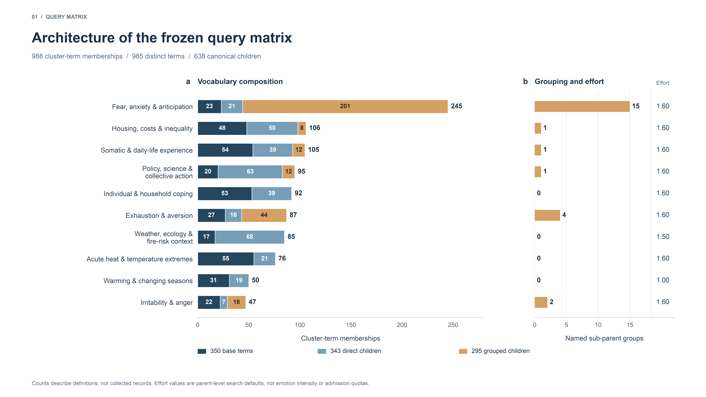
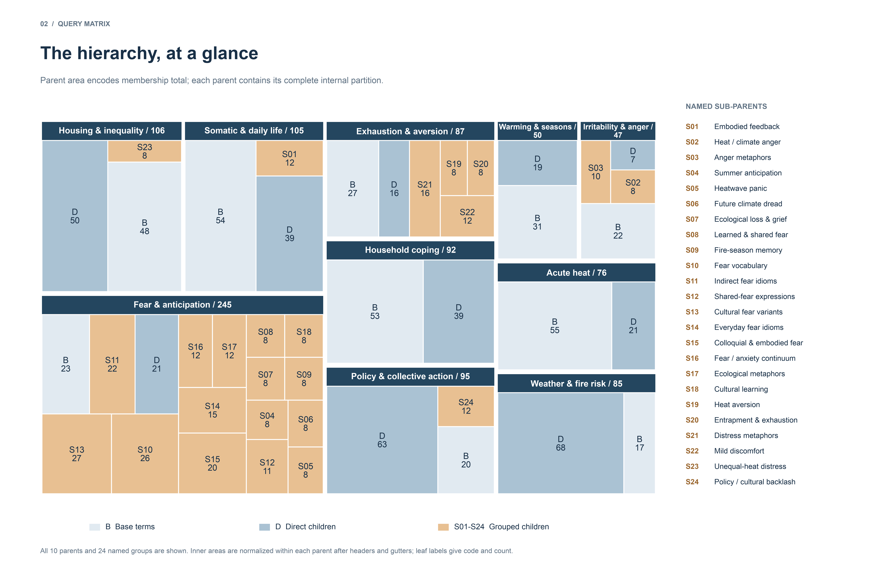
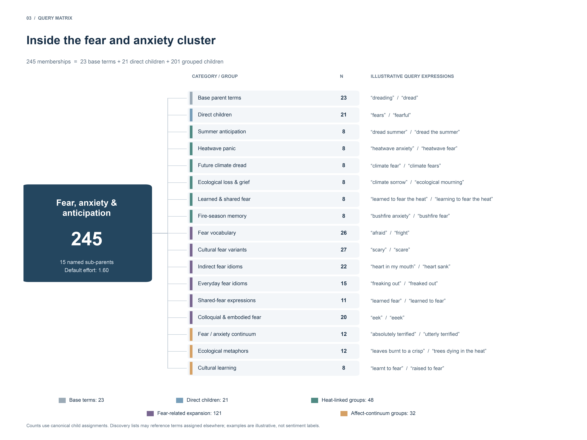
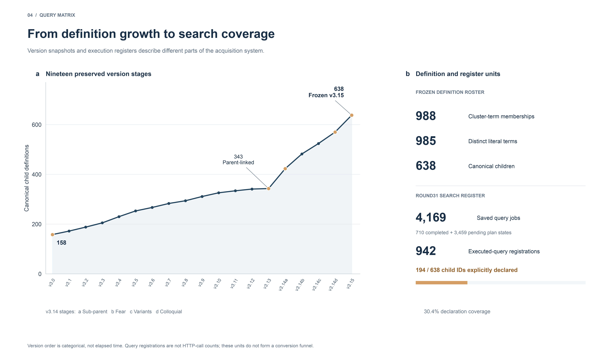
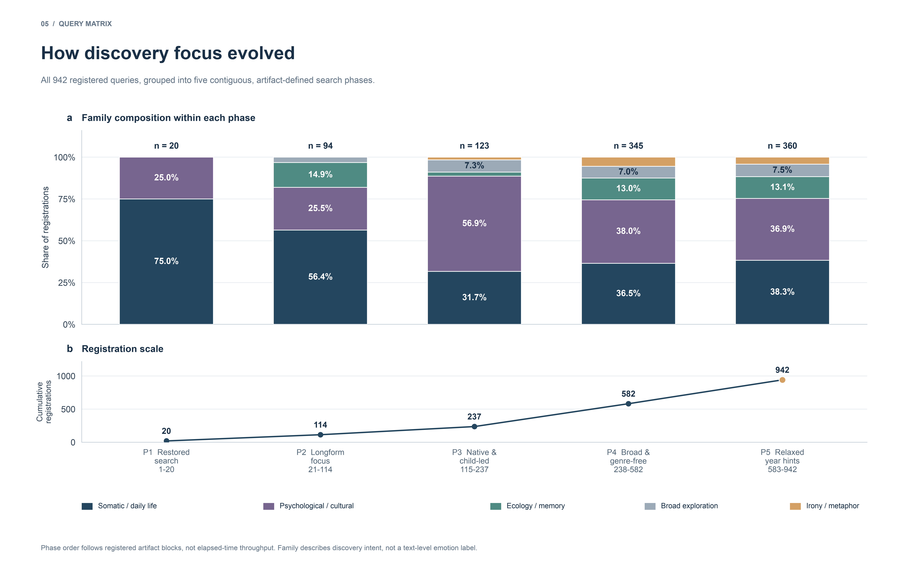
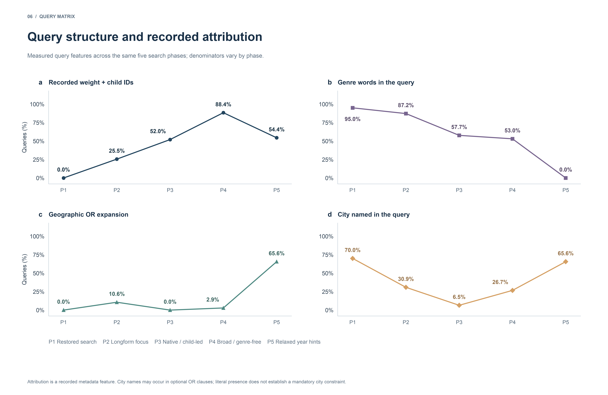
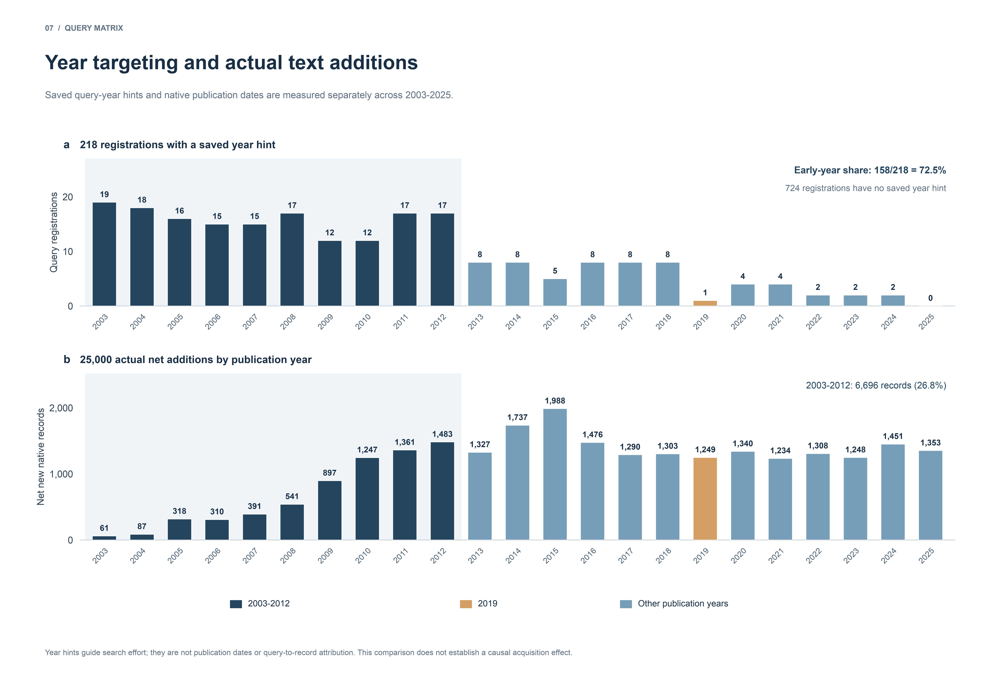

# Query Matrix and Acquisition Progress Figures

Seven English-language PNGs, each 7,200 pixels wide at 450 dpi. The complete [executed notebook](query_matrix_visualizations.ipynb) contains all plotting code and frozen inputs. A [standalone Python source](plot_all_figures.py) is also included.

Figures describe exact saved configuration/ledger aggregates. Phases are registration-order groups, not equal elapsed-time intervals; query-year hints and actual publication-year additions are separate populations. See the [figure contract](FIGURE_CONTRACT.md).

## 01 — Matrix architecture

## 02 — Nested hierarchy

## 03 — Fear taxonomy

## 04 — Version and coverage

## 05 — Search focus and progress

## 06 — Query feature evolution

## 07 — Year targeting and actual additions

## Reproduction and verification

Open the notebook with Python, NumPy, Matplotlib, Jupyter and IPython available. Run the shared setup/data cells, then each figure cell. `OUTPUT_DIR` defaults to the current working directory and can be changed before export. No corpus connection is needed.

The supplied notebook ran all nine code cells and embeds all seven figures. All seven final internal PDFs passed text and collision checks with zero collision warnings/failures; applicable alignment checks passed. If the optional local alignment auditor is absent on another machine, the code explicitly reports its more limited portable plot-area overlap check.

The chosen report-size PNG format and resolution do not assert journal-specific submission compliance. Figure sources/data and final PNGs are hash-bound in the publication manifest.
